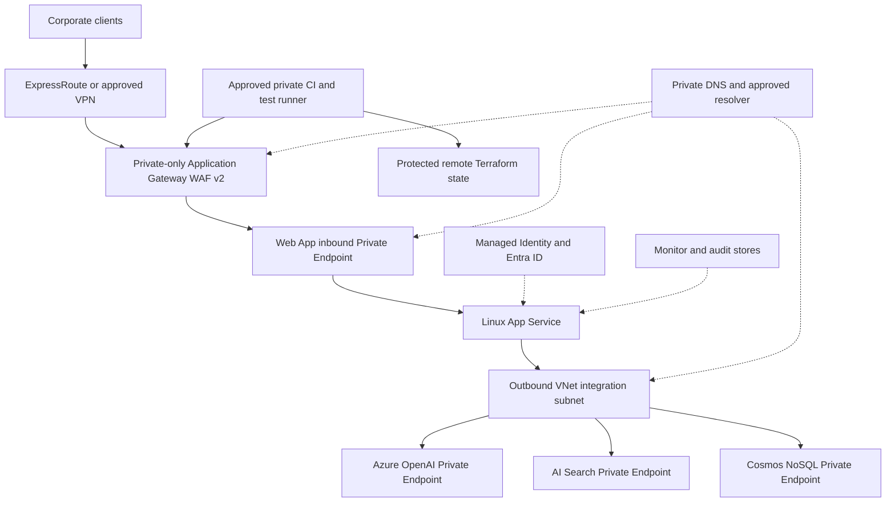

# Detailed Private-Data-Plane Architecture — Azure Private AI Assurance

**Turn 02 · Design baseline only · 2026-11-14 · Azure deployment acceptance: NOT_READY · Release: NO-GO**

## 1. Architectural decisions and boundaries

The application *business data plane* is accessible only through corporate routing (ExpressRoute or approved S2S/P2S VPN). The selected private-only Application Gateway WAF_v2 deployment terminates client TLS at a private listener and reaches Linux App Service through an **inbound App Service Private Endpoint**. The App Service **outbound VNet integration** subnet is separate from its inbound PE subnet. App dependencies—Azure OpenAI, Azure AI Search and Cosmos DB for NoSQL—use supported private endpoints, scoped data-plane identity and canonical service FQDNs resolved by approved private DNS.

The phrase “private data plane” does **not** mean every dependency is physically disconnected from the Internet. Microsoft Entra ID, ARM, trusted certificate validation, identity/distribution services, monitoring, package downloads, supported service management and Azure backbone behavior require explicit design. Close or filter business ingress without incorrectly denying necessary control and identity flows.

*Diagram denotes target logical connections, not measured traffic. Note that App Service is managed PaaS outside the customer's subnet; VNet integration provides its outbound path.*

## 2. Trust zones and network ownership

| Zone | Primary occupants | Policy intent | Evidence before acceptance |
|---|---|---|---|
| Corporate / on-premises | Approved clients, VPN/ER edge and DNS forwarders | Client TLS only to private gateway; DNS to resolver | Routes, CIDRs, ER/VPN status, client DNS responses |
| Gateway | Dedicated delegated Application Gateway subnet | Inbound approved HTTPS; supported platform flows; no public frontend | Effective gateway frontend/NSG/delegation inventory and backend health |
| Web ingress | App Service inbound Private Endpoint | Only authorized gateway and approved test sources | PE NIC IP, PE network policies, NSG/ASG and 443 tests |
| Web egress | Delegated `Microsoft.Web/serverFarms` subnet | Egress through approved NSG/UDR/DNS and private endpoints | Web VNet integration config; outbound flow observations |
| AI / data | OpenAI/Search/Cosmos Private Endpoints | Minimum authorized sources; data-plane RBAC still required | PE approvals, DNS zones, token/RBAC tests |
| Identity / secrets | User-assigned or system-assigned MI, Key Vault PE | No embedded API keys; least-privilege key and data roles | Role assignments, audit logs, cert lifecycle |
| Operations / CI | Private test runner and OIDC CI | Source/plan/read-only inventory separately from apply approval | CI identity binding, branch protection, approvals, runner routing |
| State / evidence | Protected Blob remote backend and private evidence storage | Encryption, immutability/versioning as approved, independent access controls | Blob policy, RBAC, logs, integrity and recovery evidence |

**IP ranges are intentionally not specified.** Example `10.100.0.0/16` in source proposals is not an approved IP allocation; substitute only IPAM-authorized CIDRs.

## 3. Authoritative DNS and Private Endpoint requirements

| Service | Application-facing canonical hostname (illustrative) | Private DNS zone | Subresource / owner |
|---|---|---|---|
| Azure App Service | `<web>.azurewebsites.net` | `privatelink.azurewebsites.net` | `sites`; include SCM DNS where used |
| Azure OpenAI | `<account>.openai.azure.com` | `privatelink.openai.azure.com` | `account`; validate chosen API and any additional required cognitive endpoint |
| Azure AI Search | `<search>.search.windows.net` | `privatelink.search.windows.net` | `searchService` |
| Cosmos DB NoSQL | `<account>.documents.azure.com` | `privatelink.documents.azure.com` | `Sql` |
| Key Vault | `<vault>.vault.azure.net` | `privatelink.vaultcore.azure.net` | `vault` |
| Blob state backend | `<state>.blob.core.windows.net` | `privatelink.blob.core.windows.net` | `blob` |

For each service, verify actual DNS alias chain, VNet links, central-resolver forwarding, PE connection `Approved`, final address **equal** to expected PE NIC, and TLS certificate hostname. Do **not** configure applications to talk directly to a `privatelink.*` hostname merely to force private traffic.

`Azure AI Search → other private sources` is a separate service-initiated connection; a Shared Private Link is required only when the specific indexer topology demands it and must be separately approved. Azure Monitor Private Link Scope (AMPLS) is optional according to monitoring design, not proof of complete network isolation by itself.

## 4. Allowed and denied communication matrix

| Source → destination | Protocol | Expected outcome | Independent corroboration |
|---|---|---|---|
| Corporate client → private Gateway listener | TLS/443 | ALLOW from approved routes | Client IP, TLS validity, gateway access log |
| Arbitrary public client → Gateway | No public frontend | DENY / no permitted public ingress | Gateway frontend ARM config + off-network probe |
| Gateway → Web App inbound PE | TLS/443 | ALLOW | Backend health, actual DNS and TLS/SNI |
| Unapproved VNet subnet → Web App PE | TLS/443 | DENY per implemented policy | PE network policy, effective rules, isolated test |
| App outbound integration → data PE | TLS/443 or service-specific approved | ALLOW only required services | Private DNS, flow and app operation |
| Unapproved identity → AI/Search/Cosmos API | Data-plane API | DENY | Correct data-plane role and token audience, not TCP only |
| Federated private CI → Terraform Blob state PE | HTTPS/443 | ALLOW within approved role scope | OIDC, Blob data RBAC and DNS/connection log |
| Public/unauthorized client → PaaS data plane | Service HTTPS | DENY | PNA settings plus observation; a `403` alone is not proof |
| App/runner → Entra/ARM/Monitor dependencies | Approved control traffic | ALLOW if explicitly required and monitored | Approved dependency register, egress test |

**Do not assume static traffic rules for Azure control infrastructure across gateway modes.** Feature registration, delegation and management connectivity must match the exact currently supported private Application Gateway deployment mode.

## 5. Identity and authorization

- **Human administration:** approved PIM/RBAC via controlled portal and reviewed change tickets; no assumption that WSL `az login` is available.
- **CI control plane:** scoped Workload Identity Federation; separate plan/read-only identities from apply identity. Backend Blob data access is distinct from Azure Resource Manager permissions.
- **Application workload:** managed identity for OpenAI, Search and Cosmos; local-key disablement assessed against actual SDK/feature support. Search data roles are different from Search service management roles. Cosmos NoSQL **SQL data-plane roles** are not simply ARM role assignments.
- **Gateway TLS:** approved Key Vault identity and scoped secret access; certificate rollover plus TLS SNI/Host alignment must be tested.

## 6. Audit, recovery and failure modes

Collect gateway access/firewall events, relevant app/AI/Search/Cosmos/Vault diagnostics, private DNS/flow observations and change/identity logs with retention approved by the data owner. Validate Log Analytics table modes (resource-specific vs AzureDiagnostics) and schema before executing KQL. **VNet Flow Logs** are the new-build choice rather than NSG Flow Logs. Protected evidence must be correlated by resource ID, time, request ID, commit, approved baseline, CI run and cryptographic digest; do not put raw sensitive evidence into this public repo.

Recovery coverage includes state restore/lock verification, backups and redeployment of PaaS configuration, DNS/PE recreation, key rotation and service-specific data restore. **AI Search index restoration is not assumed to exist as a native backup**: demonstrate reproducible index creation and reindexing from a preserved source dataset. Availability and RTO/RPO require a separate, approved non-production exercise.

## 7. Design-specific acceptance invariants

| Invariant ID | Invariant | Referenced steps | Minimum accepted evidence |
|---|---|---|---|
| ARCH-01 | Gateway has only the approved private frontend | 1, 24, 28, 52, 59, 62 | Azure config and off-network observation |
| ARCH-02 | App inbound PE and outbound integration are separate | 25, 26, 39, 47, 49 | Subnet/PE inventory + operational trace |
| ARCH-03 | PaaS data-plane PNA disabled and PE approved | 33, 35, 36, 38, 60 | Service configuration + PE status |
| ARCH-04 | DNS canonical host maps to intended private IP | 27, 30, 38, 48, 61 | DNS record/alias/PE NIC comparison |
| ARCH-05 | Least-privilege identity, no unapproved keys | 37, 42, 43, 65, 66 | Authorized/denied paired operations |
| ARCH-06 | TLS/SNI, WAF, logging and backend health verified | 51, 53, 54, 55, 57, 69–71 | Correlated request logs and TLS metadata |
| ARCH-07 | Remote state secured and drift/recovery controlled | 11–16, 45, 58, 68 | OIDC state access, review, recovery, drift evidence |
| ARCH-08 | Deployment remains NO-GO until accepted live evidence | 74–78 | Signed independent approval; no open P0 |

## 8. Source confidence and implementation blockers

The source material documents a designed 78-step Azure platform, not implemented Terraform/application source. **Unverified inputs:** actual subscription and resource IDs, endpoint count, CIDRs, approved DNS servers, model/SKU, TLS certificate, pinned provider schema, PIM/CI identity, app authentication flow, system logs and live test data. These are not filled from assumptions. For this public GitHub repository, all Azure live results remain zero and the release gate remains NO-GO.

**Related:** [Runbook](78-step-construction-runbook.md), [Threat model](threat-model.md), [Command recipes](command-recipes.md), [Existing target baseline](architecture-baseline.md).