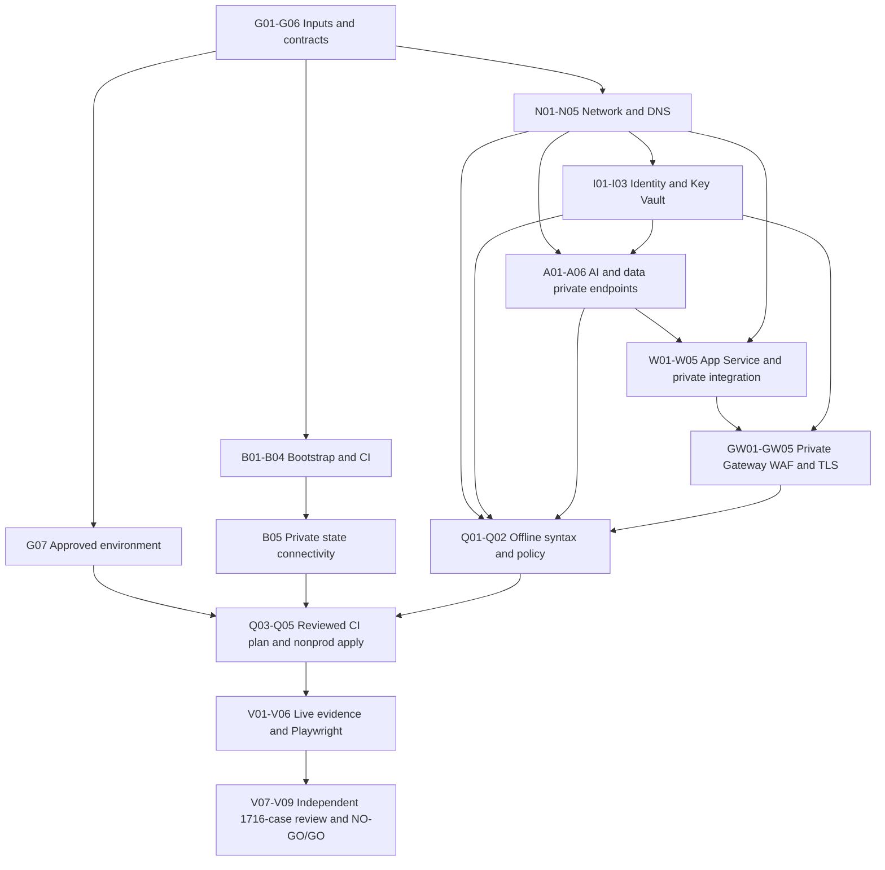

# Terraform Implementation DAG — Azure Private AI Assurance

**Design version:** 2026-11-14 | **Status:** PLANNED, Azure live PASS = **0**, release = **NO-GO**.

This is the proposed **55-node / 147-edge** source-and-approval DAG for the existing 78-step construction runbook and 1,716 verification IDs. It is not Terraform deployment code and does not authorize any Azure mutation.

## Architecture and hard boundaries

Private-only Application Gateway WAF_v2 → separate App Service **inbound PE** → Linux Web App with independent **outbound VNet Integration** → Azure OpenAI / AI Search / Cosmos DB private endpoints. Include Private DNS, least-privilege managed identity, Key Vault, Log Analytics, and protected remote Terraform state. The backend is provisioned by a **separate bootstrap stack** to avoid a circular state dependency.

Do not run `az login` on the fixed WSL workstation. Remote state requires an approved private CI path and federated identity. Plan/apply are separate reviewed nonproduction operations, never triggered by an offline detector. Optional modules (DNS Resolver, AMPLS, Search shared private links, ACR) require a documented decision.

## High-level graph



## Full 55-node dependency register

| Node | Prerequisites | Concrete deliverable | Mode |
|---|---|---|---|
| **G01** Deployment inputs and IPAM template | — | `docs/terraform-inputs-template.md` | INPUT |
| **G02** Trust boundaries and ADR | G01 | `docs/terraform-architecture-decisions.md` | DESIGN |
| **G03** Pin provider schemas and check Gateway/region support | G01 | `docs/provider-compatibility-matrix.md` | DESIGN |
| **G04** Real Terraform and application source inventory | G01 | `docs/source-ownership-inventory.md` | INPUT |
| **G05** Repository layout and secret detection | G04 | `infra/README.md` | CODE |
| **G06** Module interface contracts | G02, G03, G05 | `infra/modules/README.md` | CODE |
| **G07** Approve actual nonproduction environment | G01, G02, G03 | `evidence/restricted/approved-environment-scope.json` | APPROVAL |
| **B01** Separate bootstrap state stack | G06 | `infra/bootstrap/main.tf` | CODE |
| **B02** Secure Blob state storage | B01 | `infra/bootstrap/storage_security.tf` | CODE |
| **B03** CI runner and OIDC identity | G02, B01 | `infra/ci/identity-and-runner.md` | DESIGN |
| **B04** Private Blob endpoint and backend DNS | B02, B03 | `infra/bootstrap/private_state.tf` | CODE |
| **B05** Verified private state connectivity | B04 | `evidence/restricted/backend-readiness.json` | LIVE_GATE |
| **N01** Resource groups and tags | G06 | `infra/modules/foundation/main.tf` | CODE |
| **N02** VNet and IPAM | G01, N01 | `infra/modules/network/vnet.tf` | CODE |
| **N03** Dedicated delegated subnets | N02, G03 | `infra/modules/network/subnets.tf` | CODE |
| **N04** NSG route and egress policy | N03, G02 | `infra/modules/network/policy.tf` | CODE |
| **N05** Private DNS zones and VNet links | N02, N03 | `infra/modules/private-dns/main.tf` | CODE |
| **N06** Optional DNS Resolver | N05, G01 | `infra/modules/dns-resolver/main.tf` | OPTIONAL |
| **O01** Log Analytics diagnostics baseline | N01 | `infra/modules/monitoring/main.tf` | CODE |
| **O02** Optional AMPLS and VNet flow logs | O01, N03, N05 | `infra/modules/monitoring/private-observability.tf` | OPTIONAL |
| **I01** Managed identity | N01 | `infra/modules/identity/main.tf` | CODE |
| **I02** Key Vault security and RBAC | N01, I01 | `infra/modules/key-vault/main.tf` | CODE |
| **I03** Key Vault private endpoint | I02, N03, N05 | `infra/modules/private-endpoints/key-vault.tf` | CODE |
| **A01** Azure OpenAI account | N01, G03 | `infra/modules/azure-openai/account.tf` | CODE |
| **A02** Approved model deployment | A01, G03 | `infra/modules/azure-openai/deployment.tf` | CODE |
| **A03** Azure AI Search service | N01, G03 | `infra/modules/ai-search/main.tf` | CODE |
| **A04** Cosmos DB NoSQL | N01, G03 | `infra/modules/cosmos-db/main.tf` | CODE |
| **A05** PaaS private endpoints and DNS | A01, A03, A04, N03, N05 | `infra/modules/private-endpoints/ai-data.tf` | CODE |
| **A06** OpenAI Search Cosmos data-plane roles | I01, A01, A03, A04 | `infra/modules/identity/data-roles.tf` | CODE |
| **A07** Optional Search shared private link | A03, A05 | `infra/modules/ai-search/shared-private-link.tf` | OPTIONAL |
| **W01** Linux App Service plan | N01, G03 | `infra/modules/app-service/plan.tf` | CODE |
| **W02** Hardened Linux Web App | W01, I01 | `infra/modules/app-service/webapp.tf` | CODE |
| **W03** Outbound VNet integration | W02, N03, N04 | `infra/modules/app-service/outbound-vnet.tf` | CODE |
| **W04** Inbound Web App private endpoint | W02, N03, N05 | `infra/modules/private-endpoints/webapp.tf` | CODE |
| **W05** App settings and private AI dependencies | W02, W03, W04, A05, A06, I03 | `infra/modules/app-service/app-settings.tf` | CODE |
| **W06** Optional private ACR | W02, I01, N03, N05, B03 | `infra/modules/container-registry/main.tf` | OPTIONAL |
| **GW01** WAF policy | N01, O01 | `infra/modules/application-gateway/waf-policy.tf` | CODE |
| **GW02** TLS certificate via Key Vault | I01, I02, I03 | `infra/modules/application-gateway/tls-cert.tf` | CODE |
| **GW03** Private-only Application Gateway | GW01, GW02, N03, N04, W04, G03 | `infra/modules/application-gateway/gateway.tf` | CODE |
| **GW04** TLS listener backend and health probes | GW03, W02, W04 | `infra/modules/application-gateway/routing.tf` | CODE |
| **GW05** WAF diagnostic settings and alerts | GW04, O01 | `infra/modules/application-gateway/diagnostics.tf` | CODE |
| **Q01** Offline Terraform syntax and static QA | G05, G06, B01, B02, B04, N01, N02, N03, N04, N05, O01, I01, I02, I03, A01, A02, A03, A04, A05, A06, W01, W02, W03, W04, W05, GW01, GW02, GW03, GW04, GW05 | `evidence/offline/terraform-static.json` | OFFLINE_GATE |
| **Q02** Fail-closed Terraform policy fixtures | Q01 | `policy/terraform-plan/` | OFFLINE_GATE |
| **Q03** Authorized nonprod saved plan | Q02, B05, G07 | `evidence/restricted/nonprod-plan-manifest.json` | LIVE_GATE |
| **Q04** Two independent plan approvals | Q03 | `evidence/restricted/two-reviewer-approval.json` | APPROVAL |
| **Q05** Separate authorized nonprod apply | Q04 | `evidence/restricted/nonprod-apply-manifest.json` | LIVE_GATE |
| **V01** Live resource inventory | Q05 | `evidence/restricted/deployed-inventory.json` | LIVE_GATE |
| **V02** Private DNS TLS and backend health | V01, GW04 | `evidence/restricted/private-connectivity.json` | LIVE_GATE |
| **V03** Managed identity and AI smoke test | V01, W05 | `evidence/restricted/ai-smoke.json` | LIVE_GATE |
| **V04** Real Playwright E2E tests | V02, V03 | `evidence/restricted/playwright-junit.json` | LIVE_GATE |
| **V05** Authorized WAF and external exposure tests | V02, GW05 | `evidence/restricted/waf-and-exposure.json` | LIVE_GATE |
| **V06** Log State Drift and DR evidence | V01, O01, B05 | `evidence/restricted/operability.json` | LIVE_GATE |
| **V07** Independent evidence mapping for 1716 IDs | V04, V05, V06 | `evidence/restricted/1716-acceptance-overlay.json` | REVIEW |
| **V08** Independent security and operations acceptance | V07 | `docs/independent-acceptance-record.md` | APPROVAL |
| **V09** Formal Go or No Go decision | V08 | `docs/go-no-go-decision.md` | APPROVAL |

## Definition of Done

- A `CODE` node is complete only after its declared HCL output exists, its inputs/outputs are reviewed, and version-pinned fmt/validate/static checks run where the provider is available.
- An `OPTIONAL` node remains conditional and may be explicitly N/A following an architecture decision; its unchosen branch must not silently block an otherwise approved design.
- Any `LIVE_GATE` needs exact Azure asset IDs, resource scope, approved runner, time-stamped evidence and independent review. A synthetic/selftest PASS cannot be promoted to an Azure PASS.
- `G07`, `B05`, `Q02`, `Q04`, `Q05`, `V07`, `V08`, `V09` are safety stops. Missing inputs imply NOT_READY. Production stays NO-GO.
- Each blocked node must record a problem, route to its upstream dependency (provider/region, network, DNS, RBAC, certificate, source, or approval), and retry only after a documented correction. Do not relax public-network or privilege controls to unblock.

## First five implementation slices

1. `G05 → G06 → B01`: repo guard, module contracts, independent bootstrap Terraform stack.
2. `N01 → N02 → N03 → N04/N05`: foundation, VNet, delegated subnets, NSG/route, Private DNS.
3. In parallel, `I01/I02`, `A01/A03/A04`, `W01/W02` after their respective prerequisites.
4. `A05/A06`, `W03/W04/W05`, `GW01-GW05`: Private Endpoints, roles, web ingress/egress, WAF/TLS.
5. `Q01 → Q02`; only after `G07+B05`, `Q03 → Q04 → Q05` on approved private CI, followed by `V01-V09`.

## Safe local commands (WSL2; no Azure login)

```bash
set -Eeuo pipefail
git clone https://github.com/tayoshik/azure-private-ai-assurance.git
cd azure-private-ai-assurance
python3 scripts/verify_publication.py
python3 -m unittest discover -s tests -v
find infra -name '*.tf' -type f | sort
# When HCL has been created and the Terraform CLI is approved:
# terraform -chdir=infra/environments/dev fmt -check -recursive
# terraform -chdir=infra/environments/dev init -backend=false -input=false  # approved mirror/cache
# terraform -chdir=infra/environments/dev validate
```

Do not execute `terraform plan`, `terraform apply` or `terraform test` with unknown provider/test run modes. Saved plans may contain secrets and belong only in restricted storage, not this public repository.

## Authoritative starting material

- [`78-step runbook`](78-step-construction-runbook.md)
- [`Detailed architecture`](architecture-detailed.md)
- [`Acceptance criteria`](acceptance-criteria.md)
- [`Maintainer handoff`](maintainer-handoff.md)

**Input checkpoint:** no user action is needed to author the first Terraform modules with explicit placeholders. Real subscription/region, approved CIDRs, model quota, DNS/cert ownership and CI identity will be required at `G07` **before any real plan**.